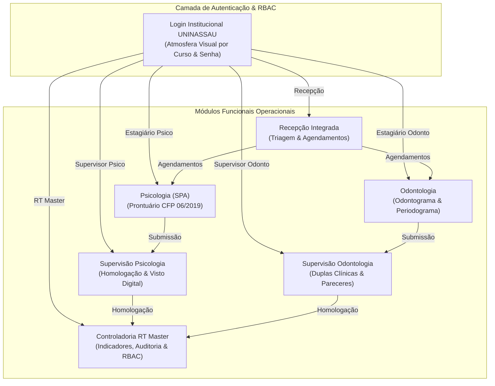

# UniCare • Sistema Integrado de Saúde Hospitalar e Clínicas-Escola
## UNINASSAU Aracaju • Documentação Executiva e Histórico Consolidado de Desenvolvimento
**Frameworks:** BMad Method (Vertical Slices) • Spec-Kit (RF-001 a RF-009 / RN-001 a RN-006) • Antigravity Kit  
**Orquestrador Técnico:** SandecoMaestro (Superior Skill)  
**Repositório Oficial:** [github.com/Gui2761/UniCare](https://github.com/Gui2761/UniCare) (Upstream: `RikelmeRoma/UniCare`)  
**Data de Emissão:** 29 de Setembro de 2026  

---

## 1. Sumário Executivo e Visão Geral da Solução

O **UniCare** é uma plataforma hospitalar e ambulatorial concebida para atender à demanda acadêmico-clínica das Clínicas-Escola da **UNINASSAU Aracaju**, integrando os cursos de **Psicologia (Serviço de Psicologia Aplicada - SPA)** e **Odontologia (Clínica Odontológica Integrada)** em um ecossistema unificado, com segregação rigorosa de papéis (RBAC - *Role-Based Access Control*), governança docente e custódia legal de prontuários.

A solução foi construída do zero, evoluindo a partir dos requisitos regulatórios do Conselho Federal de Psicologia (**Resolução CFP nº 06/2019**), do Conselho Federal de Odontologia (**CFO**) e das diretrizes da Lei Geral de Proteção de Dados (**LGPD - Lei nº 13.709/2018**, Art. 11 para dados sensíveis de saúde).



---


## 2. Matriz de Requisitos Funcionais (Spec-Kit)

### RF-001: Gestão de Recepção e Triagem
- Cadastro rápido de pacientes com validação de CPF, endereço e dados de contato.
- Agendamento ambulatorial por curso (Psicologia ou Odontologia) com status: *Agendado*, *Confirmado*, *Em Atendimento*, *Concluído* e *Faltou*.
- Métricas em tempo real de absenteísmo ambulatorial e demanda reprimida.

- **Vinculo paciente <-> estagiario responsavel (clinica de psicologia).** A recepcao
  atribui cada paciente a um estagiario; o estagiario so registra evolucao de
  paciente ativo em seu nome, e o servidor recusa a escrita nos demais. A transferencia
  move a responsabilidade e guarda o motivo na linha encerrada, que e o historico de
  quem esteve com aquele paciente. O prontuario ja registra o autor no momento da
  escrita, entao o registro clinico anterior nao e reescrito pela troca.
  *Emendado em 16/10/2026: o RF-001 descrevia recepcao e triagem sem qualquer vinculo
  de responsavel. A regra foi acrescentada aqui e a tabela `ATRIBUICOES_CLINICAS`
  entra no bloco de schema.*

### RF-002: Prontuário Eletrônico de Psicologia (SPA)
- Em conformidade integral com a **Resolução CFP nº 06/2019**.
- Registro de evolução estruturada: Identificação, Descrição da Demanda, Procedimento Técnico-Científico Adotado, Registro de Sessão e Devolutiva.
- Trava de imutabilidade e visto digital provisório até homologação do supervisor.

### RF-003: Odontograma e Periodograma Interativo (Odontologia)
- Mapeamento anatômico dos 32 dentes da dentição permanente (adulto) e faces dentárias (vestibular, lingual, mesial, distal, oclusal).
- Marcação de patologias (cárie, restauração, endodontia, prótese, extração indicada) com codificação por cores padrão CFO.
- Periodograma para mensuração de profundidade de sondagem, sangramento gengival e recessão.

### RF-004: Fila de Homologação Docente & Devolutiva Pedagógica
- Segregação de estagiários por turma e orientação docente.
- O supervisor visualiza a fila de prontuários pendentes, podendo:
  - **Aprovar e Vistar Digitalmente** (carimbo de validação com número de registro CRP/CRO).
  - **Solicitar Correção com Devolutiva Formativa** (notificação para o estagiário com orientações pedagógicas).

### RF-005: Gestão de Duplas Clínicas e Carga Horária
- Mapeamento das duplas da Clínica Integrada de Odontologia por Cadeira Clínica.
- Contabilização de procedimentos homologados vs. meta acadêmica de procedimentos mínimos por semestre.

### RF-006: Painel Executivo da RT Master & Custódia Legal
- Indicadores gerenciais de saúde da UNINASSAU Aracaju (taxa de comparecimento, volume de prontuários arquivados, procedimentos por especialidade).
- Busca e visualização de prontuários para fins de fiscalização sanitária, ética e emissão de laudos oficiais sob custódia de 20 anos (LGPD e Resoluções de Saúde).

### RF-007: Trilha de Auditoria Imutável (Audit Log)
- Gravação de logs para cada evento crítico no sistema (Login, Cadastro de Paciente, Submissão de Evolução, Homologação Docente, Edição/Exclusão de Usuários).
- Metadados capturados: Carimbo Temporal (UTC/BRT), Nome do Usuário, Matrícula, Ação, Tabela Afetada, Registro ID e Endereço IP.

### RF-008: Troca Rápida de Perfil com Imposição de Senha
- Presets rápidos para os 5 perfis fundamentais para facilitar demonstrações e rotinas de plantão.
- Salvaguarda mandatória: para alternar ou logar em qualquer conta, o operador deve confirmar a senha institucional (`Unicare123`).

### RF-009: Gerenciamento RBAC com Ciclo de Vida Completo
- A RT Master pode cadastrar, editar e excluir qualquer usuário (Supervisores, Estagiários e Operadores de Recepção).
- A Coordenação de Psicologia pode cadastrar, editar e excluir supervisores, estagiários e operadores de recepção da própria clínica. Criar ou alterar RT ou outra coordenação continua sendo ato exclusivo da RT.
- Supervisores de Psicologia podem gerenciar acadêmicos vinculados à sua turma de SPA.
- Supervisores de Odontologia podem gerenciar acadêmicos vinculados à Clínica Integrada.
- Sincronização reativa com o `localStorage` para que novos usuários cadastrados ou editados surtam efeito imediato na tela de login.

---

## 3. Arquitetura Técnica e Engenharia de Software

### Frontend
- **Framework:** React 19 com TypeScript.
- **Build Tool:** Vite 8.3.0 (compilação rápida via ESBuild / Rolldown).
- **Estilização:** Tailwind CSS v4 com sistema de design corporativo UNINASSAU (tokens de cor semânticos).
- **Ícones:** Heroicons / Micro-vetores SVG corporativos dedicados (`CorporateIcons.tsx`).
- **Gerenciamento de Estado:** React Context API modular (`AuthContext`, `ClinicContext`).

### Backend
- **Framework:** FastAPI (Python 3.12+ assíncrono).
- **Servidor ASGI:** Uvicorn rodando em `http://127.0.0.1:8000`.
- **Persistência de Dados:** PostgreSQL 16 dockerizado com ORM SQLAlchemy 2.0, schema versionado por Alembic.
- **Validação de Schemas:** Pydantic v2 com tipagem forte e serialização JSON segura.
- **Auditoria:** Trilha imutável append-only em `logs_auditoria`, gravada explicitamente por `registrar_log()` em cada rota que audita, com o IP real da requisição (`request.client.host`) e o curso de quem praticou o ato. Não há middleware de interceptação.
- **Testes Automatizados:** Pytest com suíte de conformidade regulatória (`backend/tests/test_compliance.py`).

### Modelo de Dados (PostgreSQL 16)

O schema é versionado por Alembic e possui **8 entidades de negócio** mais a tabela
técnica `alembic_version`. Existem apenas **4 foreign keys** no banco, três de
`paciente_id` para `pacientes.id` e uma da anamnese.

#### Diagrama Entidade-Relacionamento

```mermaid
erDiagram
    PACIENTES ||--o{ AGENDAMENTOS : "paciente_id"
    PACIENTES ||--o{ ANAMNESES : "paciente_id"
    PACIENTES ||--o{ PRONTUARIOS_PSICO : "paciente_id"
    PACIENTES ||--o{ FICHAS_ODONTO : "paciente_id"
    USUARIOS ||..o{ LOGS_AUDITORIA : "usuario_id (logico, sem FK)"

    USUARIOS {
        int    id PK "SERIAL"
        string nome "idx"
        string email UK "unico, idx"
        string senha_hash "bcrypt 60 chars"
        string perfil "ENUM"
        string curso "ENUM"
        string matricula UK "unica, idx"
        string registro_profissional "opcional"
        bool   ativo "desativacao logica"
    }

    PACIENTES {
        int    id PK "SERIAL"
        string nome "idx"
        string cpf_rg UK "unico, idx"
        string data_nascimento "str, nao DATE"
        string telefone
        string endereco "obrigatorio em psicologia"
        string numero "obrigatorio em psicologia"
        string complemento "opcional"
        bool   eh_menor
        string nome_responsavel "se menor"
        string contato_responsavel "se menor"
        string curso "clinica ou ambos"
        bool   prontuario_ativo
        datetime criado_em
    }

    AGENDAMENTOS {
        int    id PK
        int    paciente_id FK "idx"
        string paciente_nome "desnormalizado"
        string estagiario_nome
        string estagiario_matricula "desnormalizado"
        string curso
        string horario
        string turno
        string sala_ou_cadeira
        string tipo_consulta
        string status "ENUM 6 estados"
        string observacao_logistica "opcional"
        string motivo_falta "opcional, so com status FALTOU"
    }

    ATRIBUICOES_CLINICAS {
        int    id PK
        int    paciente_id FK "idx"
        string curso "clinica (psicologia)"
        string estagiario_nome
        string estagiario_matricula
        string situacao "ATIVA | SUBSTITUIDA"
        text   motivo "obrigatorio na transferencia"
        string atribuido_por_nome "da recepcao, do token"
        string atribuido_por_matricula
        datetime data_atribuicao
        datetime data_encerramento "se encerrada"
        datetime criado_em
    }
        ^ indice unico parcial em (paciente_id, curso) WHERE situacao='ATIVA':
          um responsavel ativo por paciente. Sem ele a aplicacao pode deixar dois.

    PRONTUARIOS_PSICO {
        int    id PK
        int    paciente_id FK "idx"
        string paciente_nome "desnormalizado"
        string estagiario_nome
        string estagiario_matricula "desnormalizado"
        string supervisor_nome "opcional"
        string data_sessao "str, nao DATE"
        string numero_sessao
        text   redacao_texto "texto unico, sem aspas, RN-002"
               ^ emendado: eram tres colunas (inicio/meio/fim). A tela obrigava o
                 estagiario a separar por fase; a restricao era de interface, nao de
                 prontuario. Quem redige conhece a ordem e escreve em paragrafos.
        text   parecer_supervisor "do supervisor"
        string status "ENUM 4 estados"
        datetime criado_em
    }

    FICHAS_ODONTO {
        int    id PK
        int    paciente_id FK "idx"
        string dupla_estagiarios
        string dente_regiao
        text   procedimento_realizado
        text   materiais_utilizados
        string anestesico "opcional"
        string alerta_alergia "opcional"
        text   parecer_supervisor "do supervisor"
        string status "ENUM 4 estados"
        datetime criado_em
    }

    ANAMNESES {
        int    id PK
        int    paciente_id FK "idx"
        datetime afetido_em "idx, ordenavel"
        string pressao_arterial "opcional"
        int    glicemia_capilar "opcional"
        int    frequencia_cardiaca "opcional"
        float  temperatura "opcional"
        text   alergias "opcional"
        text   condicoes_cronicas "opcional"
        text   medicacoes_em_uso "opcional"
        string responsavel_nome
        string responsavel_matricula
        datetime criado_em
    }

    DEMANDAS_ESTAGIO {
        int    id PK
        string aluno_nome
        string aluno_matricula "idx"
        string curso "idx"
        text   procedimento_desejado
        string prioridade "ENUM 3 niveis"
        string data_solicitacao "str"
        string status "ENUM 2 estados"
        datetime criado_em
    }

    LOGS_AUDITORIA {
        int    id PK
        int    usuario_id "idx, SEM FK"
        string usuario_nome "copia para preservar autoria"
        string acao
        string tabela_afetada
        string curso "idx"
        string endereco_ip "request.client.host"
        datetime timestamp
    }
```

#### Modelo Conceitual (notação crow's foot)

```
                          ┌──────────────────────────────────────┐
                          │             USUARIOS                 │
                          │  PK id                                │
                          │     nome                              │
                          │  UK email                             │
                          │     senha_hash (bcrypt)               │
                          │     perfil ▸ enum                    │
                          │     curso   ▸ enum                    │
                          │  UK matricula                         │
                          │     registro_profissional             │
                          │     ativo                             │
                          └───────────┬──────────────────────────┘
                                      │
                       referência lógica│ (SEM foreign key)
                       para preservar a │ trilha de auditoria
                                      │ mesmo após desativação ▼
                          ┌──────────────────────────────────────┐
                          │          LOGS_AUDITORIA              │
                          │  PK id                                │
                          │     usuario_id        (idx)          │
                          │     usuario_nome      (cópia)        │
                          │     acao                              │
                          │     tabela_afetada                   │
                          │     curso              (idx)         │
                          │     endereco_ip                       │
                          │     timestamp        (imutável)       │
                          └──────────────────────────────────────┘

                          ┌──────────────────────────────────────┐
                          │             PACIENTES                │
                          │  PK id                                │
                          │     nome                              │
                          │  UK cpf_rg          ← dado sensível │
                          │     data_nascimento                   │
                          │     telefone                          │
                          │     endereco / numero                 │
                          │     complemento (opcional)            │
                          │     eh_menor                          │
                          │     nome_responsavel / contato_resp. │
                          │     curso ▸ psicologia | odontologia  │
                          │          | ambos                    │
                          │     prontuario_ativo                  │
                          │     criado_em                         │
                          └──┬────────────┬───────────────┬───────┘
              FK paciente_id  │  FK paciente_id │  FK paciente_id │
                             │               │               │
          ┌──────────────────┘ │               └──────────────────┐
          ▼                                  ▼                                  ▼
┌───────────────────────┐        ┌───────────────────────┐        ┌───────────────────────┐
│     AGENDAMENTOS      │        │   PRONTUARIOS_PSICO   │        │     FICHAS_ODONTO     │
│  PK id                │        │  PK id                │        │  PK id                │
│  FK paciente_id       │        │  FK paciente_id       │        │  FK paciente_id       │
│     paciente_nome     │        │     paciente_nome     │        │     dupla_estagiarios │
│     estagiario_nome   │        │     estagiario_nome   │        │     dente_regiao      │
│     estag._matricula  │        │     estag._matricula  │        │     procedimento TEXT │
│     curso             │        │     supervisor_nome   │        │     materiais TEXT    │
│     horario / turno   │        │     data_sessao       │        │     anestesico        │
│     sala_ou_cadeira   │        │     numero_sessao     │        │     alerta_alergia    │
│     tipo_consulta     │        │     redacao  TEXT  │        │     parecer_sup. TEXT │
│     status ▸ enum     │        │                   │        │     status    ▸ enum  │
│     observacao_log.   │        │                   │        │     criado_em         │
│     motivo_falta      │        │                   │        │                       │
└───────────────────────┘        │     parecer_sup.  TXT │        └───────────────────────┘
                                 │     status    ▸ enum  │
                                 │     criado_em         │
                                 └───────────────────────┘

┌───────────────────────────┐
  *Emendado em 16/10/2026: a tabela DEMANDAS_ESTAGIO foi removida.*
```

#### Schema Relacional Compacto

```text
USUARIOS (id PK, nome, email UQ, senha_hash, perfil, curso, matricula UQ,
          registro_profissional, ativo)

PACIENTES (id PK, nome, cpf_rg UQ, data_nascimento, telefone, endereco,
           numero, complemento, eh_menor, nome_responsavel,
           contato_responsavel, curso, prontuario_ativo, criado_em)

AGENDAMENTOS (id PK, paciente_id FK->PACIENTES, paciente_nome,
              estagiario_nome, estagiario_matricula, curso, horario, turno,
              sala_ou_cadeira, tipo_consulta, status, observacao_logistica,
              motivo_falta)

PRONTUARIOS_PSICO (id PK, paciente_id FK->PACIENTES, paciente_nome,
                   estagiario_nome, estagiario_matricula, supervisor_nome,
                   data_sessao, numero_sessao, redacao_texto,
                   parecer_supervisor,
                   status, criado_em)

FICHAS_ODONTO (id PK, paciente_id FK->PACIENTES, dupla_estagiarios,
               dente_regiao, procedimento_realizado, materiais_utilizados,
               anestesico, alerta_alergia, parecer_supervisor, status,
               criado_em)

ANAMNESES (id PK, paciente_id FK->PACIENTES, afetido_em, pressao_arterial,
          glicemia_capilar, frequencia_cardiaca, temperatura, alergias,
          condicoes_cronicas, medicacoes_em_uso, responsavel_nome,
          responsavel_matricula, criado_em)

*Emendado em 16/10/2026: a tabela DEMANDAS_ESTAGIO foi removida.*

LOGS_AUDITORIA (id PK, usuario_id, usuario_nome, acao, tabela_afetada,
                curso, endereco_ip, timestamp)

UQ = unique   FK = foreign key   idx = índice   -> = referencia
```

#### Tipos ENUM Nativos do PostgreSQL

| Tipo | Valores gravados |
| :--- | :--- |
| `perfilusuario` | `estagiario`, `supervisor`, `recepcao`, `rt`, `coordenacao` |
| `cursousuario` | `psicologia`, `odontologia`, `geral` |
| `statusagendamento` | `AGENDADO`, `PRESENTE`, `EM_ATENDIMENTO`, `CONCLUIDO`, `FALTOU`, `CANCELADO` |
| `statusprontuario` | `EM_ELABORACAO`, `AGUARDANDO_VALIDACAO`, `VALIDADO`, `DEVOLVIDO_PARA_AJUSTE` |

#### Decisões de Modelagem

1. **Somente 4 foreign keys, todas em `paciente_id`.** Todo o resto se liga por
   campos denormalizados (`estagiario_matricula`, `supervisor_nome`,
   `aluno_matricula`, `usuario_nome`), que guardam o valor em vez de referenciar
   `usuarios`. Aclinical é preservada mesmo que o cadastro seja desativado.

2. **`logs_auditoria` não tem FK para `usuarios`, por decisão de projeto.**
   Com FK, apagar um usuário quebraria a trilha probatória do RF-007. Por isso
   `DELETE /usuarios/{id}` **desativa** (`ativo = false`) em vez de apagar, e
   `usuario_nome` fica gravado no log para a autoria sobreviver. Nenhuma rota faz
   `UPDATE` ou `DELETE` em `logs_auditoria`: a trilha é append-only.

3. **A segregação por clínica é aplicada na camada de aplicação, não por FK.**
   `usuarios.curso` e `pacientes.curso` não têm vínculo entre si no schema; a
   regra "só enxergo minha clínica" é aplicada por `cursos_visiveis()` e
   `validar_curso_do_registro()` em `app/services/auth_service.py`, em leitura e
   em escrita. `pacientes.curso = 'ambos'` é o valor que torna um paciente
   compartilhado entre as duas clínicas, e é por isso que as listagens filtram
   por `curso IN (próprio, 'ambos')`.

4. **Narrativos clínicos em `TEXT` sem limite de tamanho**, com validator de
   schema impedindo aspas literais (RN-002, CFP 06/2019). Todas as demais colunas
   têm `max_length` explícito.

5. **Pendências conhecidas do modelo:** `data_nascimento` e `data_sessao` são
   `str` e não `DATE`, o que impede ordenação e comparação — corrigir exige
   migração com reformatação dos dados existentes. CPF/RG, endereço e contatos
   de paciente estão em claro, o que não passaria em LGPD para dado real de saúde.

---

## 4. Estrutura de Arquivos do Projeto

```text
UniCare/
├── backend/
│   ├── app/
│   │   ├── config.py             # Configurações e variáveis de ambiente
│   │   ├── database.py           # Conexão PostgreSQL / SQLAlchemy
│   │   ├── main.py               # Ponto de entrada FastAPI, CORS e lifespan
│   │   ├── seed.py               # Dados de demonstração, idempotente por tabela
│   │   ├── models/               # Modelos SQLModel (paciente, prontuario, demanda…)
│   │   ├── schemas/              # Schemas Pydantic de entrada/saída
│   │   ├── routers/              # Endpoints REST (auth, usuarios, pacientes,
│   │   │                         #   agendamentos, prontuarios, atribuicoes,
│   │   │                         #   auditoria, relatorios)
│   │   └── services/             # auth_service, crypto_service, auditoria_service
│   ├── migrations/               # Alembic: fonte autoritativa do schema
│   │   └── versions/             #   4 revisões aplicadas até o head
│   ├── tests/
│   │   ├── conftest.py           # Fixture de migração e seed no unicare_test
│   │   └── test_compliance.py    # 32 testes de conformidade regulatória
│   ├── docker/                   # entrypoint.sh e initdb do banco de testes
│   ├── alembic.ini
│   ├── docker-compose.yml
│   ├── requirements.txt
│   └── pytest.ini
├── public/
│   ├── uninassau-crest.png       # Brasão oficial de alta resolução
│   └── favicon.ico
├── src/
│   ├── components/
│   │   ├── icons/CorporateIcons.tsx  # Biblioteca de ícones institucionais
│   │   └── layout/
│   │       ├── AppLayout.tsx         # Layout base com breadcrumb e avatar
│   │       └── AppSidebar.tsx        # Navegação com segregação RBAC estrita
│   ├── features/
│   │   ├── auth/                     # Módulo de Autenticação
│   │   │   ├── components/
│   │   │   │   ├── LoginForm.tsx     # Formulário de login por matrícula
│   │   │   │   ├── LoginFields.tsx   # Campos e seletor de curso
│   │   │   │   └── ProtectedRoute.tsx # Guard de papel e de clínica
│   │   │   └── context/AuthContext.tsx # Sessão real (getMe) e CRUD de usuários
│   │   ├── clinic/                   # Contexto de dados clínicos e prontuários
│   │   ├── dental-record/            # Ficha, Odontograma e Periograma
│   │   ├── psychology/               # Prontuário CFP 06/2019 e SPA
│   │   ├── reception/                # Recepção, Triagem e Agendamentos
│   │   └── supervision/              # Fila de Homologação, Duplas e RT Master
│   │       └── components/
│   │           ├── RTStatsDashboard.tsx  # Dashboard RT com CRUD de usuários
│   │           └── ClinicalPairs.tsx     # Gestão de estagiários de Odontologia
│   ├── services/
│   │   └── api.ts                 # Cliente REST: fronteira snake_case ↔ camelCase
│   ├── App.tsx                     # Rotas com ProtectedRoute por papel e curso
│   ├── main.tsx
│   ├── AGENTS.md                   # Comandos e armadilhas do repositório
│   └── STATUS.md                   # Estado do projeto e pendências
├── package.json
├── vite.config.ts
└── README.md
```

---

## 5. Credenciais Institucionais de Demonstração

Todos os usuários abaixo utilizam a senha institucional obrigatória:  
**`unicare123`**

| Perfil | Nome do Profissional / Acadêmico | Matrícula | E-mail Institucional | Curso / Área |
| :--- | :--- | :--- | :--- | :--- |
| **RT Odontologia** | Dra. Camila (Referência Técnica) | `RT-001` | `camila.rt@uninassau.edu.br` | Odontologia (RT-ODONTO) |
| **RT Psicologia** | Dr. Renato (Referência Técnica) | `RT-002` | `renato.rt@uninassau.edu.br` | Psicologia (RT-PSICO) |
| **Coordenação Psicologia** | Coordenação do Serviço de Psicologia Aplicada | `COORD-001` | `coordenacao.psi@uninassau.edu.br` | Psicologia (Coordenação) |
| **Supervisor Psico** | Prof. Dr. Robert Santos do Carmo | `DOC-8821` | `robert.carmo@uninassau.edu.br` | Psicologia (CRP 19/0844) |
| **Supervisor Odonto** | Profa. Dra. Bianca Nubia | `DOC-9122` | `bianca.silva@uninassau.edu.br` | Odontologia (CRO-SE 4512) |
| **Estagiário Psico** | Rikelme Roma Santos | `16032935` | `rikelmeroma13@gmail.com` | Psicologia (9º Período SPA) |
| **Estagiário Odonto** | Augusto Cesar Farias Carvalho | `16024402` | `augustocsar97@gmail.com` | Odontologia (Cadeira 05) |
| **Recepção Odonto** | Recepção Integrada Odontologia | `REC-001` | `recepcao@uninassau.edu.br` | Odontologia (Triagem) |
| **Recepção Psico** | Recepção do Serviço de Psicologia Aplicada | `REC-002` | `recepcao.psi@uninassau.edu.br` | Psicologia (Triagem) |

> A **Recepção é uma conta por clínica**: `REC-001` concilia a agenda de
> odontologia e `REC-002` a de psicologia. A antiga matrícula institucional
> `REC-2026-01` continua funcionando como apelido de `REC-001`.
>
> As senhas são gravadas com **bcrypt (`rounds=12`)**. Trocar o `.env` ou o
> algoritmo exige truncar a tabela `usuarios` e deixar o seed rodar de novo.

---

## 6. Status de Validação e Próximos Passos

- **Compilação TypeScript & Vite:** 100% OK (0 erros de tipagem).
- **Testes Backend Pytest:** **32 testes aprovados** com 100% de taxa de sucesso (`backend/tests/test_compliance.py`).
- **Schema do banco:** `alembic check` retorna *"No new upgrade operations detected"* — models e banco em paridade, head na revisão `c81d4e7a9b02`.
- **Repositório Git Remoto:** Sincronizado com branch `augusto` em [github.com/RikelmeRoma/UniCare](https://github.com/RikelmeRoma/UniCare).
- **Documentação de acompanhamento:** [`STATUS.md`](./STATUS.md) (estado e pendências) e [`AGENTS.md`](./AGENTS.md) (comandos e armadilhas do repositório).
- **Servidores Ativos:**
  - Frontend: [http://localhost:5173](http://localhost:5173)
  - Backend API: [http://127.0.0.1:8000/docs](http://127.0.0.1:8000/docs)
